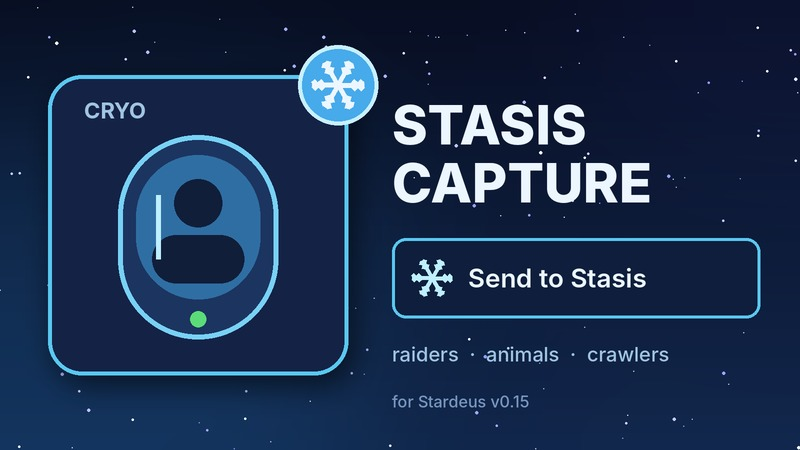

# Stasis Capture

**English** | [Русский](README.ru.md)

[](https://github.com/Gesugao-san/stardeus-stasis-capture/actions/workflows/ci.yml)

A [Stardeus](https://store.steampowered.com/app/1380910/Stardeus/) **v0.15** mod: colonists can carry any living,
incapacitated biological being into a Stasis Array — raiders, animals, crawlers and other aliens, or your own
downed colonists. In the base game only colonists who can walk go there, by themselves.



## How to use

- Select an incapacitated being (several at once work too) and press **Send to Stasis** on the bottom bar, or
- open a Stasis Array → **Send to Stasis**: below the game's list of colonists there is an **Incapacitated**
  section. An order given there prefers that very array.

A colonist who can carry beings takes the job ("Hauling") and carries the being to the nearest reachable array
with a free chamber. If the being dies or comes to on the way, the carrier puts it down and the order is
cancelled.

## Rules

- Same limits as the game: robots can't go into stasis, and an array below **90% stability** takes no one
  (unless the Asimov override is installed). Tooltips say why the button is disabled.
- **Sleepers keep their faction.** A hostile being wakes up hostile, also when low cryostability wakes sleepers on
  its own. On the wake-up choice screen such a sleeper gets a red card and a **Wake up (not a colonist)** button.
- Beings sent by the mod are ordinary sleepers of the game: they show up in the stasis manifest and wake up the
  usual way.

## Install

- **[Steam Workshop](https://steamcommunity.com/sharedfiles/filedetails/?id=3833313051):** subscribe and enable the mod in Main Menu → Mods.
- **Manually:** put the mod folder into `%USERPROFILE%\AppData\LocalLow\Kodo Linija\Stardeus\Mods\StasisCapture`
  (needs `ModInfo.json`, `ModCover.jpg`, `Translations\` and `0.15\Libraries\StasisCapture.dll`).

## Build

Requires the [.NET SDK](https://dotnet.microsoft.com/download) and Stardeus v0.15 installed (the build references
`Stardeus_Data/Managed/*.dll`):

```cmd
build.cmd                          :: game in the default Steam folder
build.cmd "D:\Games\Stardeus"      :: game elsewhere
```

The DLL is written to `0.15\Libraries\`; commit it with the code change, since CI can't build it.
On every push, GitHub Actions runs `.github/scripts/check_mod.py`: strict `ModInfo.json`, matching translation
keys and `{0}` placeholders, every key used in code translated, cover size, and the committed DLL's version.

### Release

1. Raise `ModVersion` in `ModInfo.json` and the version in `Code/AssemblyInfo.cs`.
2. Add a `## <version>` section to [CHANGELOG.md](CHANGELOG.md): it becomes the release notes.
3. Rebuild the DLL and commit it.
4. Actions → **Release** → *Run workflow*, or push the tag `v<version>`; publish the draft on the Releases page.

### Layout

| Path | What |
|---|---|
| `Code/CaptureRules.cs` | Who can be captured, which arrays can take them |
| `Code/CaptureOrder.cs` | The order: a goal on the being, and its check |
| `Code/CarryToStasisAction.cs` | AI action: walk, pick up, carry, put into stasis |
| `Code/SendToStasisEntityAction.cs` | Bottom bar button |
| `Code/StasisPanelSection.cs` | "Incapacitated" section in the Stasis Array panel (Harmony transpiler) |
| `Code/WakeUpCardStyle.cs` | Red card and button text on the wake-up choice screen |
| `Code/ModEntry.cs` | Entry point and Harmony patches |
| `Translations/` | English and Russian texts |
| `Artwork/make_cover.py` | Renders `ModCover.jpg` |

## License

[MIT](LICENSE)
