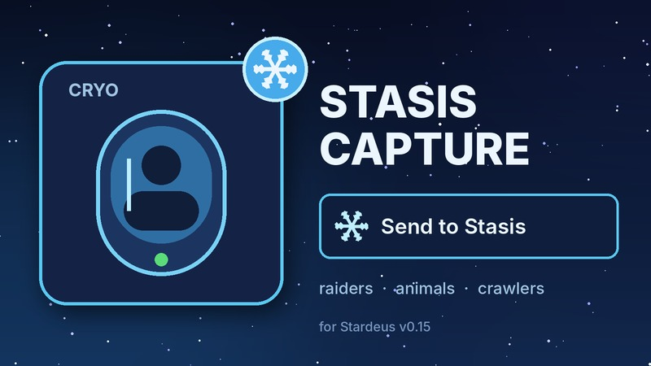

# Stasis Capture (захват в стазис)

[English](README.md) | **Русский**

[](https://github.com/Gesugao-san/stardeus-stasis-capture/actions/workflows/ci.yml)

Мод для [Stardeus](https://store.steampowered.com/app/1380910/Stardeus/) **v0.15**: колонисты могут отнести в
стазисный массив любое живое обездвиженное биологическое существо — налётчиков, животных, кроулеров и других
пришельцев, своих раненых колонистов. В обычной игре туда уходят только колонисты, которые могут идти сами.



## Как пользоваться

- Выделите обездвиженное существо (можно несколько) и нажмите **«Отправить в стазис»** на нижней панели, или
- откройте стазисный массив → **«Отправить в стазис»**: под игровым списком колонистов есть раздел
  **«Обездвиженные»**. Задание оттуда отправляет существо именно в этот массив, если в нём есть место.

Колонист, который умеет переносить, берёт задание («Перенос») и несёт существо в ближайший доступный массив со
свободной камерой. Если существо по дороге умерло или пришло в себя, носильщик кладёт его, а задание снимается.

## Правила

- Ограничения как в игре: роботов в стазис отправить нельзя, а массив со **стабильностью ниже 90%** никого не
  принимает (кроме случая с перезаписью законов Азимова). Почему кнопка недоступна — в подсказке.
- **Спящие сохраняют свою фракцию.** Враг проснётся врагом, в том числе когда низкая криостабильность будит спящих
  сама. На экране выбора пробуждения у такого спящего красная карточка и кнопка «Разбудить (не колонист)».
- Отправленные модом существа — обычные спящие игры: они есть в списке спящих и просыпаются как обычно.

## Установка

- **Мастерская Steam:** подписаться и включить мод в главном меню → «Моды».
- **Вручную:** положить папку мода в `%USERPROFILE%\AppData\LocalLow\Kodo Linija\Stardeus\Mods\StasisCapture`
  (нужны `ModInfo.json`, `ModCover.jpg`, `Translations\` и `0.15\Libraries\StasisCapture.dll`).

## Сборка

Нужны [.NET SDK](https://dotnet.microsoft.com/download) и установленная Stardeus v0.15:

```cmd
build.cmd                          :: игра в папке Steam по умолчанию
build.cmd "D:\Games\Stardeus"      :: игра в другой папке
```

DLL появится в `0.15\Libraries\`; коммитьте её вместе с кодом — CI собрать её не может. На каждый пуш
GitHub Actions запускает `.github/scripts/check_mod.py`: строгий `ModInfo.json`, одинаковые ключи и
плейсхолдеры `{0}` в переводах, перевод каждого ключа из кода, размер обложки, версию DLL.

### Релиз

1. Поднять `ModVersion` в `ModInfo.json` и версию в `Code/AssemblyInfo.cs`.
2. Добавить раздел `## <версия>` в [CHANGELOG.md](CHANGELOG.md): он станет описанием релиза.
3. Пересобрать DLL и закоммитить её.
4. Actions → **Release** → *Run workflow* или пуш тега `v<версия>`; опубликовать черновик на странице Releases.

## Лицензия

[MIT](LICENSE)
